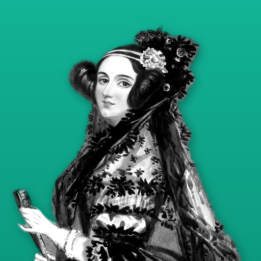

<div align="center">
  <a href="https://getnodalia.com">
    
  </a>
  <br><br>
  
  <h1>Código</h1>
  <p><strong>The code editor of the Nodalia suite.</strong></p>

  <p>
    
    
    
  </p>

  <p>
    <a href="#overview">Overview</a> ·
    <a href="#screenshots">Screenshots</a> ·
    <a href="#what-it-does">What it does</a> ·
    <a href="#download">Download</a> ·
    <a href="#build-and-run">Build</a> ·
    <a href="#project-status">Status</a> ·
    <a href="#the-nodalia-suite">Suite</a> ·
    <a href="#license">License</a>
  </p>
</div>

<p align="center">
  
</p>

---

## Overview

**Código** is the code editor of [Nodalia](https://getnodalia.com): a fast, native editor for any
language, with language servers, a terminal, a debugger, git and GitHub in the window, and code
quality and security checks built in. It is written entirely in Rust, with no Electron, Chromium or
web view, with no account and no cloud, and it wears Nodalia Design: rounded islands, the suite's
line icons in Código's green, and the suite's own window controls on Linux.

> [!IMPORTANT]
> **Código is at an early stage (0.6).** This page describes only what runs today; what is planned
> is in [`ROADMAP.md`](ROADMAP.md). Expect rough edges, and keep your work under version control.

## Screenshots

<table>
<tr>
<td width="50%" valign="top"><p align="center"><sub><b>Quality and security</b>, built in: secrets, unsafe patterns and copied code, worst first, under a quality gate.</sub></p></td>
<td width="50%" valign="top"><p align="center"><sub><b>New Nodalia app</b>: a Rust egui app in Nodalia Design, with the lints and CI the other apps use.</sub></p></td>
</tr>
</table>

## What it does

- **A text editor built for speed.** Only the rows on screen are laid out, so a file of a million
  lines opens and scrolls without trouble. Multiple cursors, find and replace, unlimited undo, and
  Unicode that behaves: the file's encoding and line endings are kept when you save.
- **Syntax highlighting for 15 languages** through tree-sitter, from Rust, Python and TypeScript to
  Go, C++, HTML and YAML. Other files open as plain text.
- **Language servers.** With one installed, Código underlines errors as you type, lists them in the
  Problems panel and offers hover, completion, go to definition, find references, rename symbol and
  format document. It never installs a server for you.
- **A terminal and a run console.** `F5` runs the project, chosen from what the folder contains
  (Cargo, npm, Go, Python, Gradle, CMake, Make and more), and a `path:line:column` in the output is
  a link.
- **A debugger** through the Debug Adapter Protocol, with breakpoints, a call stack and variables.
  Código installs no debugger: when one is missing it says which to install.
- **Git, GitHub and GitLab, in the window.** Stage by hunk, commit, branch, merge and resolve
  conflicts, and read, review and check out pull requests and merge requests (gitlab.com or your own
  server), with the services' own marks. Git is the `git` program on your computer, so your
  SSH keys and credential helper work as always.
- **Code quality and security, built in.** The Quality tab analyses the folder on your computer,
  with no server to run and nothing leaving it.
- **AI assistants, with your own key.** Chat about the open file and explain, fix, refactor or
  document a selection with Anthropic, OpenAI, Ollama or any OpenAI-compatible address. Código
  ships no key and no account, and nothing is sent until you ask.
- **Tools for building Nodalia apps.** *New Nodalia app* creates a Rust egui app in Nodalia Design,
  and the Quality tab also checks Nodalia's engineering rules in a folder that uses the theme.
- **Projects and workspace.** A file explorer that respects `.gitignore`, quick open (`Ctrl+P`),
  search across the project, a command palette and a minimap, with tabs and folders restored at the
  next launch.
- **Yours to customise.** A large Preferences window with a search: colour themes (Dracula, One
  Dark, Monokai, Solarized, GitHub, Nord, Gruvbox, Tokyo Night, Catppuccin), every colour editable,
  any installed code font, line height, cursor style, rulers, interface zoom and the terminal shell.
- **Nodalia Design.** Light, dark and high-contrast themes, round window controls on Linux (native
  ones on macOS and Windows), a global menu over D-Bus on Linux, a reduced-motion option and an
  in-app update check, in English and Spanish.

The full list, with every shortcut and what has and has not been tried against a real service, is
in [`docs/features.md`](docs/features.md).

## Download

Packages for Linux, macOS and Windows are on the
[releases page](https://github.com/getnodalia/codigo/releases/latest) and at
[getnodalia.com/codigo](https://getnodalia.com/codigo). The macOS and Windows builds are not
signed, so the system asks for confirmation the first time they open.

[Nodalia Launcher](https://getnodalia.com/launcher) installs it and keeps it up to date too.

| Platform | Files |
|---|---|
| Linux (x86-64) | `.AppImage`, `.deb`, `.rpm` and `.tar.gz` |
| macOS (11 or later) | a universal `.dmg` |
| Windows 10 and 11 (x64) | an `.msi` installer, for you only and with no administrator rights, and a portable `.zip` |

## Build and run

You need a recent stable Rust toolchain. Linux also needs the usual development packages for
windowing (`libxkbcommon`, `libwayland`, `libx11`, `libgl`, `libfontconfig`, `libdbus`).

```bash
git clone https://github.com/getnodalia/codigo.git
cd codigo
cargo run --release -p codigo-app -- path/to/folder-or-file
```

The gate that CI runs:

```bash
cargo fmt --all -- --check && cargo clippy --workspace --all-targets --locked -- -D warnings && cargo test --workspace --locked
```

## Project status

| Area | State |
|---|---|
| Editor, language servers, terminal, run console | Working |
| Debugger | Working with `lldb-dap` or GDB 14+; `dlv` and `debugpy` not tried against a real session yet |
| Git | Working |
| GitLab | Sign-in error path tried against gitlab.com; lists, comments, approvals, merge request creation, the keyring and private clones not yet run against a real account |
| GitHub | Status, diffs, staging, committing, cloning and public reads tried; reviews, the keyring and browser sign-in not yet run against a real account |
| AI assistants | Tried against a local OpenAI-compatible server; the Anthropic and OpenAI services not yet |
| App icon | Done: portrait of Alan Turing |
| Nodalia interface | Done: Nodalia theme and icons, rounded islands, main menu, Nodalia window controls on Linux |
| Global menu | Done on Linux (D-Bus), in the top bar of the shell |
| Installable packages | Linux, macOS (DMG) and Windows (MSI and zip), with an in-app update check |

## App icon

Nodalia app icons are black-and-white portraits of historical figures over the app colour.
Código's is Alan Turing, who defined what a program can compute. Provenance and licence are in
[`ATTRIBUTION.md`](ATTRIBUTION.md).

## The Nodalia suite

Código is one of the applications of [Nodalia](https://getnodalia.com), an independent software
project developed in public by [Daniel Miguel Tejedor](https://danielmigueltejedor.com). It belongs
to the Engineering suite, with Forja, Torno, Vortia, Circuito and Ábaco.

The code follows the rules in [`AGENTS.md`](AGENTS.md); security is in
[`SECURITY.md`](SECURITY.md).

## License

`MIT OR Apache-2.0`. See [`LICENSE-MIT`](LICENSE-MIT) and [`LICENSE-APACHE`](LICENSE-APACHE).
